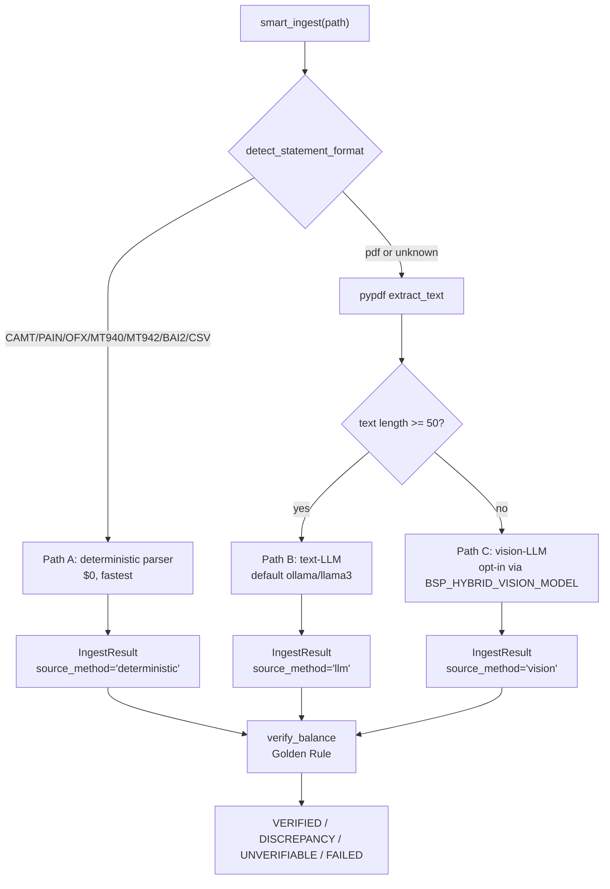

<!-- SPDX-License-Identifier: Apache-2.0 OR MIT -->
<!--
README template. Global rules: see ~/Code/AGENTS.md and ~/Code/REPO-STANDARD.md.
Releases adhere strictly to https://github.com/sebastienrousseau/passmcp/releases/tag/v0.0.5
Every image (logo, demo) uses an absolute https URL so it renders on PyPI,
crates.io, npm and other registries, which do not resolve relative paths.
-->

<p align="center">
  
</p>

<h1 align="center">bankstatementparser</h1>

<p align="center">
  Parse bank statements in eight structured formats, and PDFs digital or scanned, into one auditable <code>Transaction</code> model for Python.
</p>

<p align="center">
  <a href="https://github.com/sebastienrousseau/bankstatementparser/actions"></a>
  <a href="https://pypi.org/project/bankstatementparser/"></a>
  <a href="https://docs.bankstatementparser.com/"></a>
  <a href="https://scorecard.dev/viewer/?uri=github.com/sebastienrousseau/bankstatementparser"></a>
  <a href="LICENSE"></a>
  <a href="https://github.com/sebastienrousseau/bankstatementparser/blob/main/docs/POLICIES.md"></a>
</p>

<p align="center">
  
</p>

---

## Contents

<!-- The fragments below hold placeholders until a README fills them in. -->
<!-- markdownlint-disable MD051 -->

**Getting started**

- [Install](#install): pip and its extras, a container image, shell completions
- [Requirements](#requirements): toolchain floor, platforms
- [Quick Start](#quick-start): parse a statement in three lines

**The bankstatementparser ecosystem**

- [The bankstatementparser ecosystem](#the-bankstatementparser-ecosystem): the MCP and LSP servers, the EBICS transport, four writers and six loaders

**Library reference**

- [Capabilities at a glance](#capabilities-at-a-glance): the current surface by theme
- [Ecosystem comparison](#ecosystem-comparison): why there is no comparison table yet
- [Benchmarks](#benchmarks): headline numbers; full table at [`docs/BENCHMARKS.md`](docs/BENCHMARKS.md)
- [Features](#features): module-level capability list
- [Configuration](#configuration): core options
- [Examples](#examples): runnable example index

**Operational**

- [When not to use bankstatementparser](#when-not-to-use-bankstatementparser): limitations
- [Development](#development): make targets, fuzzing, CI
- [Security](#security): guarantees and compliance
- [Documentation](#documentation): all reference docs
- [Stability guarantees](#stability-guarantees): SemVer axis, output stability, minimum toolchain discipline
- [License](#license)

<!-- markdownlint-enable MD051 -->

---

## Install

### As a Python library

```bash
pip install bankstatementparser
```

The core install parses CAMT, PAIN.001, CSV, OFX, QFX, MT940, MT942
and BAI2 with no AI dependencies. Every extra is opt-in and pure
Python: no `poppler`, no system libraries, no GPU.

```bash
# Add Excel (.xlsx) export support (openpyxl)
pip install 'bankstatementparser[excel]'

# Add Apache Parquet export support (pyarrow)
pip install 'bankstatementparser[parquet]'

# Add Polars DataFrame export support
pip install 'bankstatementparser[polars]'

# Add the text-LLM path for digital PDFs (litellm + pypdf)
pip install 'bankstatementparser[hybrid]'

# Add higher-fidelity table extraction (adds pdfplumber)
pip install 'bankstatementparser[hybrid-plus]'

# Add the multimodal vision path for scanned/photocopied PDFs (adds pypdfium2)
pip install 'bankstatementparser[hybrid-vision]'

# Add LLM-powered transaction categorization
pip install 'bankstatementparser[enrichment]'

# Add the REST API microservice (FastAPI + uvicorn)
pip install 'bankstatementparser[api]'
```

### As a container

The repository's `Dockerfile` builds the command-line interface on
`python:3.15-slim` (pinned by digest) from the locked, hash-checked
runtime dependencies. CI builds and runs it on every change; no image
is published to a registry yet.

```bash
docker build -t bankstatementparser .
docker run --rm -v "$PWD:/data" bankstatementparser --type camt --input /data/statement.xml
```

### Shell completions

`completions/` holds bash, zsh and tcsh completions for
`bankstatementparser` and `bankstatementparser-api`, generated from the
commands' own argument parsers:

```bash
source completions/bankstatementparser.bash
```

### Package trackers

[](https://repology.org/project/python:bankstatementparser/versions)

---

## Requirements

- Python **3.10** through **3.15**. Python 3.9 was dropped in
  v0.0.6; pin to v0.0.5 if you cannot upgrade your interpreter. The
  policy, and how CI enforces it, is in
  [`docs/POLICIES.md`](docs/POLICIES.md).
- Linux, macOS and Windows: CI runs the full test suite on all three
  for every supported Python.
- Poetry, for local development.

> **Python version note.** The deterministic core (CAMT, PAIN.001,
> CSV, OFX, QFX, MT940, MT942, BAI2) supports Python **3.10 to 3.15**;
> on 3.15 it installs pandas 3, because pandas 2 has no 3.15 wheel.
> The optional `[hybrid]`, `[hybrid-plus]`, `[hybrid-vision]`, and
> `[enrichment]` extras pull in `litellm`, which currently requires
> **Python <3.14** upstream, and filelock, whose first release
> without open advisories (4.2.1) dropped 3.10. The LLM extras
> therefore need Python **3.11 to 3.13**; on 3.10, 3.14 or 3.15 they
> install without `litellm`. Use Python 3.11 to 3.13 for the full hybrid
> pipeline; any supported version works for deterministic parsing.
> The `pdfplumber` engine in `[hybrid-plus]` needs Python **3.11+**:
> it pulls Pillow, whose first release without open advisories
> (13.0.0) dropped 3.10, so on 3.10 the extra installs without it.

---

## Quick Start

```python
from bankstatementparser import CamtParser

parser = CamtParser("statement.xml")
transactions = parser.parse()
print(transactions)
```

```text
   Amount Currency DrCr  Debtor Creditor      ValDt      AccountId
 105678.5      SEK CRDT MUELLER          2010-10-18 50000000054910
-200000.0      SEK DBIT                  2010-10-18 50000000054910
  30000.0      SEK CRDT                  2010-10-18 50000000054910
```

`CamtParser` reads a CAMT.053 file into a pandas DataFrame, one row
per entry. Other formats have their own parser (`Pain001Parser`,
`Mt940Parser`, `Bai2Parser`, and so on), `create_parser()` picks one
for you, and `smart_ingest()` handles PDFs too; see
[Features](#features). From the shell:

```bash
bankstatementparser --type camt --input statement.xml
```

---

## The bankstatementparser ecosystem

`bankstatementparser` is the core engine. Companion packages build on
it, each its own repository and Python package, so you install only
what you need and the core stays dependency-light. Loaders turn
another source format into the same `Transaction` model; writers take
parsed data out to another target. Every package releases in lockstep
under the same version.

| Component | Purpose | Use case |
| :--- | :--- | :--- |
| [`bankstatementparser`](https://pypi.org/project/bankstatementparser/) | Core engine: parsers for CAMT (052/053/054), PAIN.001, CSV, OFX, QFX, MT940, MT942, BAI2, and PDF statements | Parse a statement file into transactions |
| [`bankstatementparser-mcp`](https://github.com/sebastienrousseau/bankstatementparser-mcp) | Model Context Protocol (MCP) server exposing statement tools to LLMs and AI agents | Let an agent read and summarise statements |
| [`bankstatementparser-lsp`](https://github.com/sebastienrousseau/bankstatementparser-lsp) | Language Server Protocol (LSP) server with live SWIFT MT940 validation and diagnostics | Edit statement files with diagnostics in your editor |
| [`bankstatementparser-transport-ebics`](https://github.com/sebastienrousseau/bankstatementparser-transport-ebics) | Statement retrieval over EBICS 3.0 (`H005`) and 2.5 (`H004`) | Fetch statements from a bank automatically |
| [`bankstatementparser-writer-xlsx`](https://github.com/sebastienrousseau/bankstatementparser-writer-xlsx) | Styled Microsoft Excel (`.xlsx`) workbooks | Hand transactions to spreadsheet users |
| [`bankstatementparser-writer-qif`](https://github.com/sebastienrousseau/bankstatementparser-writer-qif) | Quicken Interchange Format (`.qif`) files | Import into Quicken-compatible tools |
| [`bankstatementparser-writer-ofx`](https://github.com/sebastienrousseau/bankstatementparser-writer-ofx) | Open Financial Exchange (`.ofx`) files | Import into OFX-compatible accounting tools |
| [`bankstatementparser-writer-swift`](https://github.com/sebastienrousseau/bankstatementparser-writer-swift) | SWIFT MT940 customer statements and MT942 interim reports | Produce SWIFT statements from parsed data |
| [`bankstatementparser-loader-bai2`](https://github.com/sebastienrousseau/bankstatementparser-loader-bai2) | BAI2 cash-management and account balance statements | Load BAI2 files as `Transaction` objects |
| [`bankstatementparser-loader-mt942`](https://github.com/sebastienrousseau/bankstatementparser-loader-mt942) | SWIFT MT942 interim reports with credit/debit summary reconciliation | Load intraday MT942 reports |
| [`bankstatementparser-loader-cfonb`](https://github.com/sebastienrousseau/bankstatementparser-loader-cfonb) | French CFONB 120 / AFB120 fixed-width statements | Load French bank statements |
| [`bankstatementparser-loader-camt054`](https://github.com/sebastienrousseau/bankstatementparser-loader-camt054) | ISO 20022 CAMT.054 debit/credit notifications | Load real-time notification streams |
| [`bankstatementparser-loader-sepa`](https://github.com/sebastienrousseau/bankstatementparser-loader-sepa) | ISO 20022 PAIN.002 payment status reports and PAIN.008 direct debit mandates | Load SEPA status and mandate files |
| [`bankstatementparser-loader-bacs`](https://github.com/sebastienrousseau/bankstatementparser-loader-bacs) | UK BACS Standard 18 / Faster Payments 106-byte fixed-width files | Load UK BACS transmissions |

```bash
# Mix and match: e.g. fetch via EBICS 3.0, parse CAMT.053, and export to SWIFT MT940 or Excel
pip install bankstatementparser-transport-ebics bankstatementparser-writer-swift bankstatementparser-writer-xlsx
```

Loaders hand back the same `Transaction` model the core parsers
produce, so `load_mt942_file(...)` then `write_xlsx(...)` composes
cleanly; see each companion's README for runnable examples. Each
companion pins `bankstatementparser` as a dependency and ships its own
100%-coverage test suite.

---

## Capabilities at a glance

| Area | Capability | Status |
| :--- | :--- | :--- |
| Parsing | CAMT.052, CAMT.053, CAMT.054, PAIN.001, MT940, MT942, BAI2, OFX, QFX, CSV | Core install |
| Parsing | Format detection and parser factory (`detect_statement_format()`, `create_parser()`) | Core install |
| Parsing | Streaming with bounded memory, parallel multi-file parsing, in-memory parsing | Core install |
| PDFs | Hybrid pipeline: deterministic first, then text LLM, then vision (`smart_ingest()`) | Opt-in extras |
| Verification | Golden Rule balance checks, overall and per currency | Core install |
| Data quality | Idempotent deduplication by versioned hash, suspected-match detection | Core install |
| Enrichment | LLM categorisation, regex account mapping | Categorisation is an extra |
| Export | CSV, JSON, Excel, Parquet, Polars, hledger, beancount | Excel, Parquet, Polars are extras |
| Interfaces | `bankstatementparser` CLI, FastAPI REST service | REST is an extra |
| Security | PII redaction, XXE-safe XML, ZIP-bomb and path-traversal checks | Core install |
| Extensibility | Third-party loaders and writers through entry points | Core install |

---

## Ecosystem comparison

No comparison is published yet. A fair comparison needs the same files
run through each alternative library and the results checked, and that
work has not been done, so this README makes no claims about other
projects.

---

## Benchmarks

Measured with the repository's own benchmarks (`benches/`), best of
three runs, uninstrumented. CI enforces lower floors under coverage
(`tests/test_performance_contracts.py`).

| Scenario | Result | Environment |
| :--- | ---: | :--- |
| CAMT.053 streaming, 10,000 transactions | 23,273 tx/s (43 µs/tx) | Apple M1 Pro, macOS 27.2.1, CPython 3.12.16 |
| PAIN.001 streaming, 10,000 transactions | 56,311 tx/s (18 µs/tx) | Apple M1 Pro, macOS 27.2.1, CPython 3.12.16 |
| CAMT.053 time to first record, 50,000 transactions | 0.89 ms | Apple M1 Pro, macOS 27.2.1, CPython 3.12.16 |
| Deduplication, 8,000 distinct transactions | 156 ms (19.5 µs/tx, linear) | Apple M1 Pro, macOS 27.2.1, CPython 3.12.16 |
| Deduplication, 800 identical in a batch of 4,000 | 2.42 s (near quadratic in the group) | Apple M1 Pro, macOS 27.2.1, CPython 3.12.16 |

Streaming throughput is flat from 1,000 to 50,000 transactions.

See [`docs/BENCHMARKS.md`](docs/BENCHMARKS.md) for methodology and full results.

---

## Features

### Key Features

#### Parsing

| Feature | Description |
|---|---|
| **8 structured formats** | CAMT (052, 053, 054), PAIN.001, MT940, MT942, BAI2, OFX, QFX, CSV |
| **Auto-detection** | `detect_statement_format()` identifies the format; `create_parser()` returns the right parser |
| **Streaming** | `parse_streaming()` with bounded memory: about 23,000 tx/s (CAMT) and 56,000 tx/s (PAIN.001) in [Benchmarks](#benchmarks) |
| **Parallel** | `parse_files_parallel()` for multi-file batch processing across CPU cores |
| **In-memory parsing** | `from_string()` and `from_bytes()` parse XML without touching disk |

#### Hybrid PDF pipeline (LLM-assisted)

| Feature | Description |
|---|---|
| **Hybrid PDF pipeline** *(v0.0.5)* | `smart_ingest()` routes digital PDFs through a text-LLM and scanned PDFs through a multimodal vision model. Deterministic parsers always tried first ($0 cost). |
| **Local-first LLM** *(v0.0.5)* | Ollama is the default backend; switch to Anthropic, OpenAI, or any LiteLLM provider via `BSP_HYBRID_MODEL`. Vision is opt-in via `BSP_HYBRID_VISION_MODEL`: no surprise downloads. |
| **Direct Ollama bridge** *(v0.0.7)* | Auto-bypasses the upstream LiteLLM to Ollama hang on long vision prompts. `ollama/minicpm-v` recommended over `ollama/llava` for document OCR. |
| **Strip mode** *(v0.0.7)* | `VisionExtractor(strip_rows=True)` splits dense pages into overlapping bands for small local models, which fixes sign-flip errors and improves accuracy on 15+ row statements. |
| **Bounding boxes** *(v0.0.6)* | `Transaction.source_bbox` carries per-row normalized coordinates from the vision path for downstream review UIs. |
| **Bulk directory scanner** *(v0.0.8)* | `scan_and_ingest(directory, pattern="**/*.pdf")` scans a folder tree, runs `smart_ingest` on every match, deduplicates across the entire batch. |

#### Data quality and verification

| Feature | Description |
|---|---|
| **Golden Rule verification** *(v0.0.5)* | Every result carries `opening + credits − debits == closing` status: `VERIFIED`, `DISCREPANCY`, `UNVERIFIABLE`, or `FAILED`. |
| **Multi-currency verification** *(v0.0.8)* | `verify_balance_multi_currency()` groups transactions by currency and runs the Golden Rule independently per group, so multi-currency statements no longer report a false `DISCREPANCY`. |
| **Idempotent dedup** *(v0.0.5)* | Every `Transaction` carries a stable `transaction_hash` (versioned SHA-256 of account, currency, date, description, amount, and bank identity). `Deduplicator.dedupe_by_hash()` makes incremental ingestion safe to re-run. |
| **Interactive review** *(v0.0.6)* | `--type review` CLI walks through discrepancies with accept/edit/skip/delete/quit. `IngestResult.to_json()` / `.from_json()` for stable round-trip with embedded audit trail. |

#### Enrichment and export

| Feature | Description |
|---|---|
| **Categorization** *(v0.0.6)* | `bankstatementparser.enrichment.Categorizer` tags transactions with a pluggable category schema (Plaid 13-category default) and an optional `is_business_expense` flag. Wrapper model: it never mutates the original `Transaction`. |
| **Account mapping** *(v0.0.8)* | `AccountMapper` with ordered regex rules loaded from JSON config. First match wins. Pairs with the ledger exporter for end-to-end plaintext-accounting workflows. |
| **hledger + beancount export** *(v0.0.8)* | `to_hledger()` and `to_beancount()` produce journal strings for plaintext-accounting workflows. Uses `Transaction.category` as the contra-account when set. |
| **Export** | CSV, JSON, Excel (`.xlsx`), Apache Parquet (`.parquet`), and optional Polars DataFrames |
| **REST API** *(v0.0.8)* | FastAPI microservice: `POST /ingest` a file, get JSON back. `GET /health` for monitoring. `pip install 'bankstatementparser[api]'`. |

#### Security and quality

| Feature | Description |
|---|---|
| **PII redaction** | Names, IBANs, and addresses masked by default; opt in with `--show-pii` |
| **Secure ZIP** | `iter_secure_xml_entries()` rejects zip bombs, encrypted entries, and suspicious compression ratios |
| **Tested** | 1091 tests, coverage gated at 100% in CI on Linux, macOS and Windows, property-based testing with Hypothesis, and Atheris fuzzing of the parsers |

### How it works

`smart_ingest()` routes any input file through the cheapest viable
extraction path. Deterministic parsers always run first ($0 cost).
Text and vision LLMs are fallbacks for unstandardized PDFs; both are
opt-in via separate install extras and can be swapped between any
LiteLLM-supported provider (Ollama, Anthropic, OpenAI, Gemini, and
others).



Every extracted row carries an immutable `transaction_hash`, an
audit-trail `source_method` tag, and (for LLM rows) a `confidence`
score; see [Hybrid extraction](#hybrid-extraction-pdfs-included)
below for the full surface. The module layout is described in
[`docs/ARCHITECTURE.md`](docs/ARCHITECTURE.md).

### Parse a PAIN.001 payment file

```python
from bankstatementparser import Pain001Parser

parser = Pain001Parser("payment.xml")
payments = parser.parse()
print(payments)
```

```text
  PmtInfId PmtMtd  InstdAmt Currency  CdtrNm         EndToEndId
  PMT-001  TRF     1500.00  EUR       ACME Corp      E2E-001
  PMT-001  TRF     2300.50  EUR       Global Ltd     E2E-002
```

### Auto-detect the format

```python
from bankstatementparser import create_parser, detect_statement_format

fmt = detect_statement_format("transactions.ofx")
parser = create_parser("transactions.ofx", fmt)
records = parser.parse()
```

Works with `.xml`, `.csv`, `.ofx`, `.qfx`, and `.mt940` files.

### Hybrid extraction (PDFs included)

`smart_ingest()` (v0.0.5) is the single entry point that routes any
file through the cheapest viable extraction path:

```python
from bankstatementparser.hybrid import smart_ingest

# Path A: deterministic parser (free, fastest, $0)
result = smart_ingest("statement.xml")
print(result.source_method)  # "deterministic"

# Path B: text-LLM for digital PDFs (set BSP_HYBRID_MODEL=ollama/llama3)
result = smart_ingest("statement.pdf")
print(result.source_method)  # "llm"
print(
    result.verification.status
)  # VERIFIED | DISCREPANCY | UNVERIFIABLE | FAILED

# Path C: multimodal vision for scanned PDFs (set BSP_HYBRID_VISION_MODEL)
# auto-routed when pypdf cannot extract enough text
result = smart_ingest("scan.pdf")
print(result.source_method)  # "vision"
```

Every row carries:

- `source_method`: `"deterministic"`, `"llm"`, or `"vision"` for
  full audit provenance
- `transaction_hash`: versioned SHA-256 fingerprint scoped to account,
  currency, date, description, amount, and available bank identity.
  Rebuild persisted pre-v2 keys before re-ingestion
- `confidence`: float between 0 and 1 for LLM rows, `None` for
  deterministic
- `raw_source_text`: best-effort source-text slice for the v0.0.6
  review-mode UI

A complete walkthrough with synthetic UK-bank PDFs, mock vs. live
mode, and a Mermaid flow diagram lives in
[`examples/hybrid/README.md`](examples/hybrid/README.md).

### Parse from memory (no disk I/O)

```python
from bankstatementparser import CamtParser

xml_bytes = download_from_sftp()  # your own function
parser = CamtParser.from_bytes(xml_bytes, source_name="daily.xml")
transactions = parser.parse()
```

Pass only decompressed XML to `from_string()` or `from_bytes()`.
For ZIP archives, use `iter_secure_xml_entries()`.

### Parse XML files inside a ZIP archive

```python
from bankstatementparser import CamtParser, iter_secure_xml_entries

for entry in iter_secure_xml_entries("statements.zip"):
    parser = CamtParser.from_bytes(
        entry.xml_bytes, source_name=entry.source_name
    )
    transactions = parser.parse()
    print(entry.source_name, len(transactions), "transactions")
```

The iterator enforces size limits, blocks encrypted entries, and
rejects suspicious compression ratios before any XML parsing
occurs.

### PII redaction

PII (names, IBANs, addresses) is **redacted by default** in
CLI console output. Python parser methods return full records unless
`redact_pii=True` is supplied.

```python
# Request redaction explicitly in Python
for tx in parser.parse_streaming(redact_pii=True):
    print(tx)  # Names and addresses show as ***REDACTED***

# Opt in to see full data
for tx in parser.parse_streaming(redact_pii=False):
    print(tx)
```

Regular and hybrid file exports contain full records. Legacy CLI streaming
exports follow `--show-pii`; Python exports reflect the records supplied.
Choose redaction explicitly before sharing an exported file.

### Streaming

Process large files incrementally. Memory stays bounded regardless
of file size, tested at 50,000 transactions with sub-2x memory
scaling.

```python
from bankstatementparser import CamtParser

parser = CamtParser("large_statement.xml")
for transaction in parser.parse_streaming():
    process(transaction)  # each transaction is a dict
```

Works with both `CamtParser` and `Pain001Parser`. PAIN.001 files
over 50 MB use chunk-based namespace stripping via a temporary
file, so the full document is never loaded into memory.

### Parallel parsing

Process multiple files simultaneously across CPU cores:

```python
from bankstatementparser import parse_files_parallel

results = parse_files_parallel(
    [
        "statements/jan.xml",
        "statements/feb.xml",
        "statements/mar.xml",
    ]
)

for r in results:
    print(r.path, r.status, len(r.transactions), "rows")
```

Uses `ProcessPoolExecutor` to bypass the GIL. Each file is parsed
in its own worker process. Auto-detects format per file, or force
with `format_name="camt"`.

### Command line

After installation a `bankstatementparser` console script is
available on `PATH`:

```bash
# Parse and display
bankstatementparser --type camt --input statement.xml

# Export to CSV
bankstatementparser --type camt --input statement.xml --output transactions.csv

# Stream with PII visible
bankstatementparser --type camt --input statement.xml --streaming --show-pii

# v0.0.5: hybrid pipeline (auto-routes deterministic / text-LLM / vision)
bankstatementparser --type ingest --input statement.pdf
bankstatementparser --type ingest --input statement.pdf --output ledger.csv

# v0.0.6: interactive review of saved IngestResult JSON
bankstatementparser --type review --input result.json
bankstatementparser --type review --input result.json --output reviewed.json

# v0.0.9: also review rows the LLM was unsure about (confidence < 0.8)
bankstatementparser --type review --input result.json --review-below 0.8
```

Supports `--type camt`, `--type pain001`, `--type ingest`
(v0.0.5), and `--type review` (v0.0.6). The
`python -m bankstatementparser.cli ...` invocation form continues
to work for parity with older releases.

### REST API

```bash
pip install 'bankstatementparser[api]'
bankstatementparser-api --port 8000

# POST a file, get JSON back
curl -F file=@statement.pdf http://localhost:8000/ingest

# Health check
curl http://localhost:8000/health
```

Default bind is `127.0.0.1` (localhost-only). Use
`--host 0.0.0.0` for container deployments. Its security defaults are
listed under [Security](#security).

### Deduplication

Detect duplicate transactions across multiple sources:

```python
from bankstatementparser import CamtParser, Deduplicator

parser = CamtParser("statement.xml")
dedup = Deduplicator()
result = dedup.deduplicate(dedup.from_dataframe(parser.parse()))

print(f"Unique: {len(result.unique_transactions)}")
print(f"Exact duplicates: {len(result.exact_duplicates)}")
print(f"Suspected matches: {len(result.suspected_matches)}")
```

The `Deduplicator` uses deterministic hashing for exact matches
and configurable similarity thresholds for suspected matches. Each
match group includes a confidence score and reason for
auditability.

### Export

```python
parser = CamtParser("statement.xml")
parser.parse()

# CSV
parser.export_csv("output.csv")

# JSON (includes summary + transactions)
parser.export_json("output.json")

# Excel
parser.camt_to_excel("output.xlsx")
```

#### Polars (optional)

Convert any parser output to a Polars DataFrame:

```python
polars_df = parser.to_polars()
lazy_df = parser.to_polars_lazy()
```

Install with `pip install bankstatementparser[polars]`.

#### Apache Parquet (optional)

Export transactions to Apache Parquet columnar files in batch or streaming mode:

```python
import pyarrow as pa
from bankstatementparser.export import export_parquet, ParquetStreamWriter

# Batch export
export_parquet(transactions, "output.parquet")

# Streaming export with bounded memory and atomic file commits. The writer
# takes mappings and an explicit Arrow schema covering every field written.
schema = pa.schema([
    ("booking_date", pa.date32()),
    ("amount", pa.decimal128(18, 2)),
    ("currency", pa.string()),
    ("description", pa.string()),
])
with ParquetStreamWriter("output_stream.parquet", schema=schema, batch_size=1000) as writer:
    for tx in transactions:
        writer.write_record(tx.model_dump(include=set(schema.names)))
```

Install with `pip install 'bankstatementparser[parquet]'`.

#### hledger and beancount

Export transactions to plaintext-accounting journal formats (v0.0.8):

```python
from bankstatementparser.export import to_hledger, to_beancount

journal = to_hledger(transactions, account="Assets:Bank:Checking")
Path("journal.ledger").write_text(journal)

# Or beancount format:
journal = to_beancount(transactions, account="Assets:Bank:Checking")
```

Uses `Transaction.category` as the contra-account when set by the
enrichment module.

#### Bulk directory scanner

Scan a folder tree and ingest every statement, deduplicating
across the batch (v0.0.8):

```python
from bankstatementparser.hybrid import scan_and_ingest

batch = scan_and_ingest("statements/2026/", pattern="**/*.pdf")
print(f"{batch.file_count} files, {batch.total_unique} unique transactions")
```

#### Account mapping

Map transactions to ledger accounts via configurable regex rules (v0.0.8):

```python
from bankstatementparser.enrichment import AccountMapper

mapper = AccountMapper.from_json("mapping.json")
for tx, account in zip(transactions, mapper.map_batch(transactions)):
    print(f"{tx.description} -> {account}")
```

#### Multi-currency verification

```python
from bankstatementparser.hybrid import verify_balance_multi_currency

results = verify_balance_multi_currency(
    transactions,
    balances={"GBP": (opening, closing), "EUR": (opening, closing)},
)
for currency, v in results.items():
    print(f"{currency}: {v.status.value}")
```

### XML tag mapping

See [`docs/MAPPING.md`](docs/MAPPING.md) for a complete reference
of ISO 20022 XML tags to DataFrame columns across all structured formats.
Use this when integrating with ERP systems or building
reconciliation pipelines.

---

## Configuration

Parsers take their options as arguments (for example `redact_pii`,
`format_name`, `source_name`); the CLI flags are in
[Command line](#command-line). The optional services read these
environment variables:

| Variable | Read by | Effect |
| :--- | :--- | :--- |
| `BSP_HYBRID_MODEL` | Hybrid text path, categorizer fallback | LiteLLM model name; default `ollama/llama3` |
| `BSP_HYBRID_VISION_MODEL` | Hybrid vision path | Vision model name; the vision path needs it set |
| `BSP_HYBRID_ENRICHMENT_MODEL` | `Categorizer` | Model for categorisation; falls back to `BSP_HYBRID_MODEL` |
| `BSP_HYBRID_API_BASE` | Vision path, direct Ollama bridge | Model server base URL; Ollama's default is `http://localhost:11434` |
| `BSP_API_MAX_UPLOAD_BYTES` | REST API | Upload size cap; default 25 MB |

---

## Examples

See [`examples/`](examples/README.md) for 23 runnable scripts
(14 deterministic + 9 hybrid):

### Deterministic parsers

| Example | What it demonstrates |
|---|---|
| `parse_camt_basic.py` | Load a CAMT.053 file and print transactions |
| `parse_camt_from_string.py` | Parse CAMT from an in-memory XML string |
| `inspect_camt.py` | Extract balances, stats, and summaries |
| `export_camt.py` | Export to CSV and JSON |
| `export_camt_excel.py` | Export to Excel workbook |
| `stream_camt.py` | Stream transactions incrementally |
| `parse_camt_zip.py` | Secure ZIP archive processing |
| `parse_detected_formats.py` | Auto-detect CSV, OFX, MT940, and XML formats |
| `parse_pain001_basic.py` | Parse a PAIN.001 payment file |
| `export_pain001.py` | Export PAIN.001 to CSV and JSON |
| `stream_pain001.py` | Stream payments incrementally |
| `validate_input.py` | Validate file paths with InputValidator |
| `compatibility_wrappers.py` | Legacy API wrappers |
| `cli_examples.sh` | CLI commands for CAMT and PAIN.001 |

### Hybrid pipeline

| Example | What it demonstrates |
|---|---|
| `hybrid/generate_sample_pdfs.py` | Produce reproducible synthetic UK-bank PDFs (digital + scanned) |
| `hybrid/01_smart_ingest_deterministic.py` | Path A: `smart_ingest()` against a CAMT.053 fixture, $0 cost |
| `hybrid/02_smart_ingest_text_llm.py` | Path B: text-LLM extraction from a digital PDF (mock or live Ollama) |
| `hybrid/03_smart_ingest_vision.py` | Path C: multimodal vision extraction with `LOW_TEXT_DENSITY` auto-routing |
| `hybrid/04_golden_rule.py` | `verify_balance()`, `verify_transactions()`, and `verify_continuity()` across `VERIFIED` / `DISCREPANCY` / `UNVERIFIABLE` outcomes |
| `hybrid/05_dedupe_recurring.py` | `normalize_description()` + `dedupe_by_hash()` for idempotent batching |
| `hybrid/06_cli_walkthrough.sh` | Four flavours of the `--type ingest` CLI subcommand |
| `hybrid/06_cli_walkthrough.ps1` | PowerShell sibling of the bash walkthrough (native Windows) |
| `hybrid/07_scan_and_ingest.py` | Bulk directory ingest with `scan_and_ingest()`: cross-file dedup + continuity check |

See [`examples/hybrid/README.md`](examples/hybrid/README.md) for
the full walkthrough including a Mermaid flow diagram, the
cross-platform verification matrix, and the Ollama smoke-test
results.

---

## When not to use bankstatementparser

- **You need to fetch statements from a bank.** This package reads
  files; retrieval over EBICS is
  [`bankstatementparser-transport-ebics`](https://github.com/sebastienrousseau/bankstatementparser-transport-ebics).
- **You need to write SWIFT, OFX, QIF or styled Excel files.** Use the
  writer packages in [the ecosystem](#the-bankstatementparser-ecosystem).
- **You need byte-identical results from PDFs.** Only the
  deterministic parsers are deterministic. The PDF path depends on a
  language model, can drop or misread rows, and reports its confidence
  and a Golden Rule verdict rather than a guarantee.
- **You need an internet-facing API as is.** The REST service has no
  authentication, authorization or rate limiting; put it behind a
  reverse proxy or gateway that does.
- **You deduplicate huge groups of identical transactions.** The
  matcher's cost grows close to quadratically with the size of one
  duplicate group (2.4 s for 800 identical rows in a batch of 4,000 in
  [Benchmarks](#benchmarks)).
- **You need a frozen API.** The project is in its `0.y.z` series; see
  [Stability guarantees](#stability-guarantees).

---

## Development

```bash
git clone https://github.com/sebastienrousseau/bankstatementparser.git
cd bankstatementparser
poetry install --with dev -E excel
make install-hooks   # pre-commit hook runs `make verify` before every commit
make verify          # lint, format, mypy, complexity, completions, README, tests, bandit
make completions     # regenerate completions/ from the CLI parsers
make docs            # build the manual with mkdocs --strict
make demo            # re-render .github/demo.gif from .github/demo.tape (needs vhs)
make fuzz            # Atheris fuzzing of the parsers (Linux x86_64)
```

`make verify` runs locally what CI runs on every change: ruff lint and
format, mypy, the complexity baseline (`scripts/complexity_baseline.json`,
which may only shrink), the completions and README template checks,
the test suite at 100% coverage, and bandit. CI adds the Python 3.10
to 3.15 matrix on Linux, macOS and Windows, 120 seconds of Atheris
fuzzing, the container build, pip-audit against the lock, CodeQL,
gitleaks, markdownlint, OpenSSF Scorecard and the strict documentation
build.

Signed commits are required. See [CONTRIBUTING.md](CONTRIBUTING.md).

### Project layout

```text
bankstatementparser/            Source code (55 modules)
bankstatementparser/analytics/  Financial metrics, cash flow, cadence & anomaly detection
bankstatementparser/parsers/    Modular statement parsers (CSV, MT940, MT942, BAI2, OFX/QFX)
bankstatementparser/hybrid/     PDF pipeline: orchestrator, llm_extractor, vision, scanner, ollama_direct, verification
bankstatementparser/enrichment/ Categorizer, AccountMapper, EnrichedTransaction
bankstatementparser/export/     hledger + beancount journal export, Apache Parquet columnar export
bankstatementparser/api.py      REST API microservice (FastAPI)
benches/                        Streaming and deduplication benchmarks
completions/                    Generated bash, zsh and tcsh completions
docs/                           The manual: architecture, policies, benchmarks, API reference
docs/compliance/                ISO 13485 validation, risk register, traceability matrix
examples/                       14 deterministic + 9 hybrid runnable example scripts
fuzz/                           Atheris fuzz target for the parsers
scripts/                        SBOM generation, checksums, signature verification, release gates
tests/                          1091 tests (unit, integration, property-based, security, hybrid mocks)
```

---

## Security

Bank statement files contain sensitive financial and personal
data. This library is designed with security as a primary
constraint:

- **XXE protection**: `resolve_entities=False`,
  `no_network=True`, `load_dtd=False`
- **ZIP bomb protection**: compression ratio limits, entry size
  caps, encrypted entry rejection
- **Path traversal prevention**: dangerous pattern blocklist,
  symlink resolution
- **PII redaction**: default masking of names, IBANs, and
  addresses
- **Signed commits**: enforced in CI via GitHub API verification
- **Supply chain**: SHA-256 hash-locked dependencies, CycloneDX
  SBOM, pip-audit in CI, and releases signed with cosign and shipped
  with SLSA Level 3 provenance and GitHub build attestations

The REST API's defaults:

- Uploads are streamed in chunks; the request is rejected with
  **413 Payload Too Large** once the cumulative size exceeds
  `BSP_API_MAX_UPLOAD_BYTES` (default **25 MB**).
- The uploaded filename is reduced to its basename (caller-supplied
  path components are dropped) and the suffix must match one of the
  allowed input extensions (`.xml`, `.csv`, `.ofx`, `.qfx`, `.mt940`,
  `.sta`, `.pdf`, `.json`). Anything else returns
  **400 Bad Request**.
- On parse failure the response carries a UUID `correlation_id`;
  the raw exception is logged server-side only. Status
  **422 Unprocessable Entity**.
- **Authentication, authorization, and rate limiting are out of
  scope** for this microservice: wire them in your reverse proxy
  (nginx `auth_basic` + `limit_req`, a WAF, or an API gateway).
  The default `127.0.0.1` bind means a fresh
  `bankstatementparser-api` is never publicly reachable unless you
  explicitly opt in via `--host 0.0.0.0`.

For the full compliance suite, see
[`docs/compliance/`](docs/compliance/).

Report vulnerabilities according to [`SECURITY.md`](SECURITY.md).

---

## Documentation

| Document | Covers |
|---|---|
| [User manual](https://docs.bankstatementparser.com/) | The manual and full API reference generated from docstrings (MkDocs Material + mkdocstrings), deployed from `main`. Build locally with `make docs`. |
| [`docs/ARCHITECTURE.md`](docs/ARCHITECTURE.md) | How the modules fit together, from entry points to export. |
| [`docs/POLICIES.md`](docs/POLICIES.md) | Supported Python versions, versioning, how support is enforced. |
| [`docs/BENCHMARKS.md`](docs/BENCHMARKS.md) | Benchmark methodology and results. |
| [`docs/MAPPING.md`](docs/MAPPING.md) | ISO 20022 XML tag to DataFrame column mapping. |
| [`FAQ.md`](FAQ.md) | Data privacy, determinism, technical specs, treasury workflows. |
| [`CONTRIBUTING.md`](CONTRIBUTING.md) | Signed-commit policy, the local gates, PR guidelines. |
| [`CHANGELOG.md`](CHANGELOG.md) | Per-release notes following Keep a Changelog. |
| [`SECURITY.md`](SECURITY.md) | Disclosure policy, supported versions, contact. |
| [`docs/compliance/`](docs/compliance/) | ISO 13485 validation, risk register, traceability matrix. |
| [`examples/hybrid/README.md`](examples/hybrid/README.md) | Hybrid-pipeline walkthrough: mock vs. live mode, verification matrix, Ollama smoke tests. |

---

## Stability guarantees

- **Versioning.** This project follows
  [Semantic Versioning](https://semver.org). While the version is
  `0.y.z`, any release may contain breaking changes; they are always
  listed under a **Changed — BREAKING** heading in the
  [CHANGELOG](CHANGELOG.md) with migration notes. From `1.0.0`,
  breaking changes will require a major release.
- **Deprecations** emit `DeprecationWarning` for at least one minor
  release before removal.
- **Output stability.** The deterministic parsers produce the same
  output for the same input, and golden-file tests
  (`tests/test_golden_files.py`) pin it. `transaction_hash` is
  versioned (currently `v2:`); keys persisted under an earlier scheme
  must be rebuilt before re-ingestion.
- **Minimum toolchain.** Python 3.10 to 3.15, tested on Linux, macOS
  and Windows. A Python version is dropped only in a release whose
  CHANGELOG says so; see [`docs/POLICIES.md`](docs/POLICIES.md).
- **Lockstep releases.** Core and every companion package share one
  version number per release.

---

## License

Dual-licensed under either the
[Apache License, Version 2.0](LICENSE-APACHE) or the
[MIT license](LICENSE-MIT), at your option. See [LICENSE](LICENSE).

See [CHANGELOG.md](CHANGELOG.md) for release history.

<p align="right"><a href="#contents">Back to Top</a></p>
