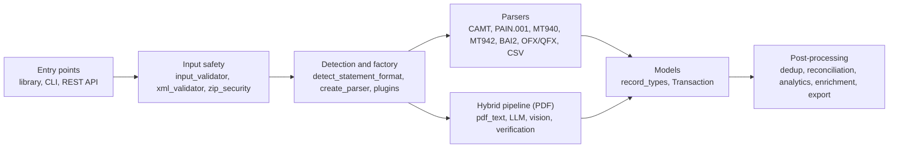

# Architecture

`bankstatementparser` turns bank statement files into one transaction
model. Every input goes through the same four stages: an entry point,
input safety checks, a format-specific parser, and optional
post-processing. PDFs add a fifth path, the hybrid pipeline, that falls
back to a language model only when no deterministic parser applies.

## Entry points

| Module | Role |
| :--- | :--- |
| `bankstatementparser/__init__.py` | The public library API. `__all__` is the supported surface; `__version__` is a literal so the release gate can compare it with `pyproject.toml`. |
| `cli.py` | The `bankstatementparser` console script (`--type camt`, `pain001`, `ingest`, `review`). Console output redacts PII unless `--show-pii` is given. |
| `api.py`, `api_limits.py`, `api_worker.py` | The optional FastAPI service (`bankstatementparser-api`, `[api]` extra). Uploads are streamed with a size cap, filenames reduced to a basename with an allowed suffix, and parsing runs in a `ProcessPoolExecutor` worker so a slow or hostile file cannot block the event loop. |

The two console scripts build their argument parsers in
`BankStatementCLI.setup_arg_parser()` and `api.build_arg_parser()`;
`scripts/generate_completions.py` derives the shell completions in
`completions/` from the same parsers.

## Input safety

Every parser validates its input before reading it.

- `input_validator.py` checks paths (traversal patterns, symlinks),
  file size bounds and allowed suffixes, and raises `ValidationError`.
- `xml_validator.py` rejects binary content and bad source labels
  before XML parsing. XML is parsed with lxml configured with
  `resolve_entities=False`, `no_network=True` and no DTD loading, so
  XXE and network fetches are off.
- `zip_security.py` (`iter_secure_xml_entries()`) yields XML entries
  from an archive after checking entry sizes, compression ratios and
  encryption, before any XML is parsed.

## Detection, factory and plugins

`additional_parsers.py` holds `detect_statement_format()`, which
decides by the XML root for `.xml` files, then by suffix, then by
content, then by registered plugins, and `create_parser()`, which maps a format name to a parser
class. `plugins.py` discovers third-party loaders and writers through
the `bankstatementparser.loaders` and `bankstatementparser.writers`
entry-point groups; the suite's loader and writer packages register
themselves there.

## Parsers

All parsers derive from `base_parser.BankStatementParser`, which
defines `parse()` (a pandas DataFrame), summaries, and the CSV, JSON
and Excel exports, with CSV formula-injection sanitising.

| Module | Formats |
| :--- | :--- |
| `camt_parser.py` | CAMT.053 statements, in memory or streamed (`parse_streaming()`), including from strings or bytes. |
| `camt_reports.py` | CAMT.052 intraday reports and CAMT.054 notifications, streamed. |
| `pain001_parser.py` | PAIN.001 credit transfer initiations; files over 50 MB have namespaces stripped in chunks through a temporary file. |
| `parsers/mt940.py`, `parsers/mt942.py`, `field86_parser.py` | SWIFT MT940 statements and MT942 interim reports, with structured Field 86 narratives. |
| `parsers/bai2.py` | BAI2 cash-management files. |
| `parsers/ofx.py` | OFX and QFX. |
| `parsers/csv_parser.py` | CSV with column-name normalisation and sniffed delimiters. |
| `bank_statement_parsers.py` | Deprecated compatibility wrappers for the pre-0.0.5 API. |

Amounts are parsed by `_amounts.iso_decimal()` into finite `Decimal`
values; a malformed amount raises instead of becoming `0.0`.

## Models

`record_types.py` defines the `TypedDict` records the parsers emit
(balances, transactions, payments, statistics).
`transaction_models.Transaction` is the pydantic model shared by the
hybrid pipeline, deduplication and export. It carries a versioned
SHA-256 `transaction_hash`, the `source_method` that produced it
(`deterministic`, `llm` or `vision`), a `confidence` for model output
and an optional `BoundingBox`.

## Hybrid pipeline

`hybrid/orchestrator.smart_ingest()` is the single entry point for any
file. It tries the deterministic parser first. For a PDF or an
unknown file it extracts text with `hybrid/pdf_text.py`; with enough
text it asks a text model (`hybrid/llm_extractor.py`, through LiteLLM,
or `hybrid/ollama_direct.py` for Ollama), otherwise a vision model
(`hybrid/vision.py`, opt-in). `hybrid/verification.py` applies the
Golden Rule (opening + credits - debits = closing) and returns
`VERIFIED`, `DISCREPANCY`, `UNVERIFIABLE` or `FAILED`;
`verify_balance_multi_currency()` applies it to each currency
separately.
`hybrid/scanner.py` runs the pipeline over a directory and
deduplicates across the batch; `hybrid/evaluation.py` scores model
accuracy against ground truth. All model dependencies are optional
extras; the core install has none.

## Post-processing

| Module | Role |
| :--- | :--- |
| `transaction_deduplicator.py` | Exact duplicates by deterministic hash, suspected matches by similarity, each with a reason and confidence. |
| `reconciliation.py` | Two-way matching of payments (PAIN.001) to statement lines. |
| `analytics/` | Cash-flow spreading, average daily balance, recurring cadence and anomaly detection. |
| `enrichment/` | `Categorizer` (LiteLLM) and `AccountMapper` (ordered regex rules). |
| `export/` | hledger and beancount journals, Apache Parquet (batch and streaming). |
| `privacy.py` | Field redaction for displays and explicit exports. |
| `forensics.py` | PDF integrity checks for tampering signs. |
| `parallel.py` | `parse_files_parallel()` across processes. |
| `telemetry.py` | Structured logging and optional OpenTelemetry spans. |

## Errors

`exceptions.py` roots the library's own errors at
`BankStatementParserError` (`ValidationError`, `ParserError`,
`ExportError`). Malformed input raises one of those, a `ValueError`
(bad encoding, a garbled amount) or lxml's `XMLSyntaxError`;
`fuzz/fuzz_parsers.py` treats any other exception as a defect.

## Quality gates

`make verify` runs what CI runs: ruff (lint and format), mypy, the
complexity baseline (`scripts/check_complexity.py`), the completions
check, the test suite at 100% coverage, and bandit. CI adds the OS
and Python matrix, the Atheris fuzz job, the container build,
pip-audit against the lock, CodeQL, the README template gate and
markdownlint, and the strict MkDocs build of this manual.
